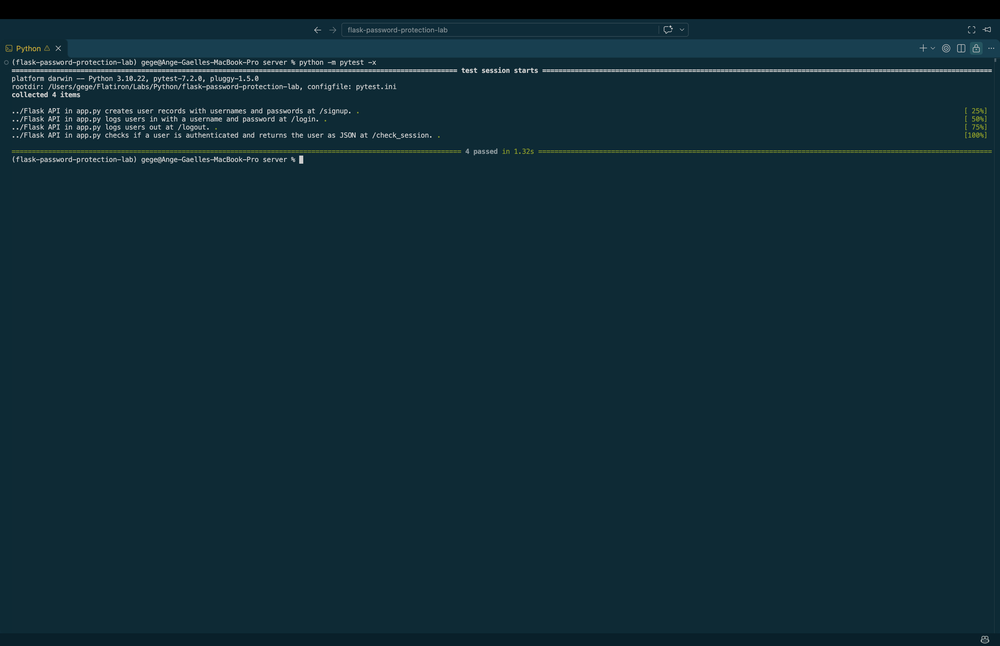

# Flask Password Protection Lab

## Overview

This lab implements password-based authentication in a Flask REST API with a React frontend. Users can sign up, log in, maintain an authenticated session, and log out. Passwords are securely hashed using Bcrypt rather than stored as plaintext in the database.

## Learning Objectives

- Implement secure password hashing using Bcrypt.
- Protect sensitive model attributes with hybrid properties.
- Authenticate users by verifying their passwords.
- Manage authentication state using Flask sessions.
- Create RESTful authentication endpoints.
- Serialize user data using Marshmallow.
- Test backend functionality using Pytest.

## Technologies Used

- Python 3.10
- Flask
- Flask-RESTful
- Flask-SQLAlchemy
- Flask-Migrate
- Flask-Bcrypt
- Marshmallow
- SQLite
- React
- Pytest
- Pipenv

## Implementation

### User Model

The User model implements three password-related methods:

- `password_hash`: Prevents direct reading of the password
  hash by raising an exception.
- `password_hash.setter`: Hashes the submitted password
  using Bcrypt before storing it in `_password_hash`.
- `authenticate()`: Verifies a submitted password against
  the stored password hash.

### API Endpoints

| Method | Endpoint | Description |
|--------|----------|-------------|
| POST | `/signup` | Creates and authenticates a new user. |
| GET | `/check_session` | Checks the user's authentication state. |
| POST | `/login` | Authenticates an existing user. |
| DELETE | `/logout` | Removes the user's authenticated session. |

### HTTP Status Codes

| Status Code | Description |
|-------------|-------------|
| 200 | Successful login or authenticated session check. |
| 201 | User successfully created. |
| 204 | Successful logout or no authenticated session. |
| 401 | Invalid login credentials. |

## Installation and Setup

### Clone Repository 
```bash
git clone git@github.com:a-gbatie/flask-password-protection-lab.git
cd flask-password-protection-lab
```

Install backend dependencies and activate the virtual
environment:

```bash
pipenv install --python 3.10
pipenv shell
```

Install frontend dependencies:

```bash
npm install --prefix client
```

Apply database migrations:

```bash
cd server
flask db upgrade head
```

## Running the Application

Start the Flask backend from the server directory:

```bash
python app.py
```

Start the React frontend in a separate terminal from
the project root:

```bash
npm start --prefix client
```

## Testing

Run the automated test suite from the server directory:

```bash
python -m pytest -x
```

The tests cover:

- User registration
- Password-based login
- Session verification
- User logout

## Screenshot of Completed Tests

